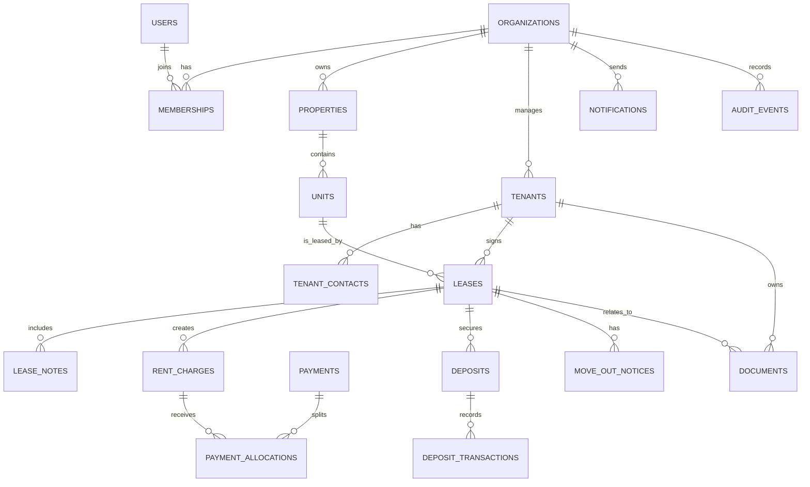

# Entity relationship diagram

The proposed relational model supports the template and avoids assuming that one property equals one unit.

`payment_allocations` resolves the many-to-many relationship between payments and rent charges. A document may reference a tenant, a lease, or both; constrain it to reference at least one.
